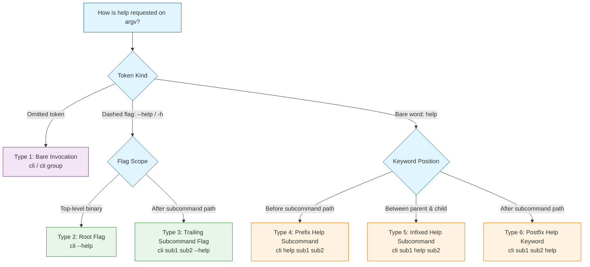
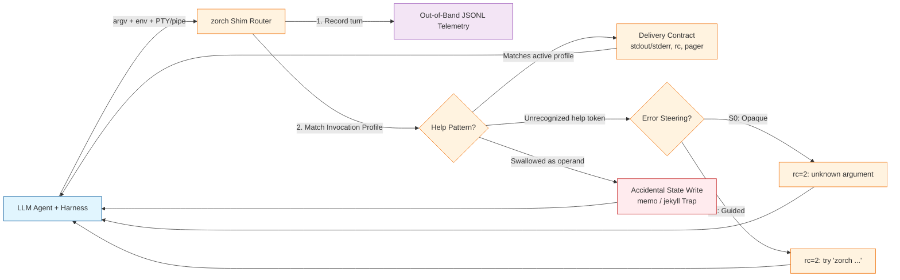

{::options toc_levels="2" /}
1. Table of Contents
{:toc}

---

I was working with [OptMem](https://github.com/VictorTaelin/OptMem), an append-only memory tool for AI coding agents, when I wanted to check the usage and byte limit for its note subcommand. I typed what decades of Unix habit trained me to type:

```sh
memo note --help
```

The terminal answered:

```text
Saved as #196.
```

Instead of printing help text, OptMem wrote the seven-character string "\--help" directly into the permanent, append-only memory log.

A look at `cmd_note` in the script shows why:

```python
def cmd_note(d, args):
    if len(args) != 1:
        die("usage: %s note \"<one line, at most %d bytes>\""
            % (ME, ENTRY_CHARS))
    text = check(args[0])
    i = log_append(d, [(datetime.date.today().isoformat(), text)])
    print("Saved as #%d." % i)
```

Running `memo` with no arguments prints the full command table and exits cleanly, and running `memo note` with no arguments hits the length guard and prints the usage line. Passing `memo note --help` satisfies that one-argument check, so the function treats "\--help" as the memory payload and appends it to disk.

As a human at a shell prompt, I always reach for `<full command I want> --help` first. You type the command path down to the exact subcommand you intend to run - say, `git remote add` or `gh pr list` - and tack the help flag onto the end when your memory gives out. Once you read the synopsis, you hit the up arrow, backspace over the flag, type your real arguments, and press Enter.

That incident raised two questions:

First, **what does the rest of the command-line world actually do** - and what should we call the competing shapes out there?

Second, now that LLM agents inside coding harnesses are heavy consumers of CLI help text, **how do we test whether one pattern genuinely outperforms the others** across models and harnesses?

Those answers would compose into a disposition: If **we** are going to write a CLI, how should it expose its "help" content so that it's easy for everyone - human and AI alike - to understand?

## The Standard That Stops at the Root

No formal specification defines how subcommand help should work.

The [POSIX Utility Conventions][posix-12] codify single-letter short options (`-a`, `-v`), require options to precede positional operands, and reserve `--` as the end-of-options delimiter under Guideline 10. POSIX says nothing about a help flag. Its accompanying [rationale document](https://pubs.opengroup.org/onlinepubs/9699919799/xrat/V4_xbd_chap12.html) mentions `ls --help` only in passing as a "permitted extension."

The [GNU Coding Standards](https://www.gnu.org/prep/standards/html_node/_002d_002dhelp.html) provide the only widely followed formal rule: every program should support a `--help` option that writes brief usage documentation to standard output (stdout), ignores all other options and arguments once seen, and exits successfully. GNU wrote that rule for flat utilities like ls, grep, and tar. It says nothing about nested command trees like `git remote add` or `aws ec2 describe-instances`.

Modern practitioner guides try to cover the gap by recommending every common pattern at once. Both [Command Line Interface Guidelines](https://clig.dev/#help) (clig.dev) and Jeff Dickey's [12 Factor CLI Apps][12factor] advise supporting `-h` and `--help` on the root binary and every subcommand, alongside `mycli help` and `mycli help subcommand`.

In practice, CLI authors rarely design help routing by hand unless they are writing a minimal argument dispatch table like OptMem. What governs the ecosystem is what the major argument-parsing libraries generate out of the box.

## Typology, Taxonomy, or Ontology?

Before naming the patterns, it helps to separate three classification words that often get blurred together:

- **Typology:** A conceptual grid formed by crossing analytical dimensions (following Kenneth Bailey's distinction in [*Typologies and Taxonomies*](https://books.google.com/books?id=1TaYulGjhLYC)). Here, crossing **token kind** (a dashed option flag like `--help` versus a bare positional word like `help`) with **syntactic position** in the command tree (bare, root, prefix, infixed, or postfix) produces six structural types.
- **Taxonomy:** An empirical classification that sorts observed specimens - real libraries like Cobra, clap, and argparse, and real binaries like git, ip, and aws - into those buckets.
- **Ontology:** A specification of entities, their properties, and the operational relationships between them. For CLI help, an ontology covers both the invocation syntax on argv and the execution contract it triggers: whether the parser short-circuits argument validation, which stream receives the text (stdout versus stderr), whether a TTY spawns an interactive pager (less, man, or a browser), and what exit code terminates the process.

The diagram below shows how crossing those two dimensions splits an argv help request into six structural types:



Each type routes through the parser differently and breaks in its own characteristic way:

- **Type 1 (Bare Invocation):** Triggers a zero-argument fallback when a required subcommand is omitted (memo, gh, npm, pip). 
	- *Primary failure mode:* executes the default action instead of printing help if the command requires no arguments (`memo wake`, `jekyll build`).
- **Type 2 (Root Flag):** Intercepts the help flag at the top-level parser before command dispatch (GNU coreutils, almost all CLIs).
	- *Primary failure mode:* in flat parsers (`apt list --help`), dumps global top-level help and ignores the subcommand.
- **Type 3 (Trailing Subcommand Flag):** Transfers option parsing to the active subcommand's parser, which intercepts `--help` locally (kubectl, docker, gh, uv, cargo, pip).
	- *Primary failure mode:* naive sub-parsers without option scanning swallow the flag as a positional operand (`memo note --help`).
- **Type 4 (Prefix Help Subcommand):** Dispatches to a root help verb that resolves the remaining tokens as a command path (git, go, gh, uv, cargo, pip, gem). 
	- *Primary failure mode:* fails on flag-only frameworks (argparse, Click) and requires cursoring back to the root to rewrite the command.
- **Type 5 (Infixed Help Subcommand):** Each parent subcommand registers its own local help verb to inspect child commands (urfave/cli, Ruby Thor, default clap). 
	- *Primary failure mode:* fails on root-only help routers (`gh pr help list`) and forces users to guess tree depth.
- **Type 6 (Postfix Help Keyword):** Intercepts the bare word help at the end of a subcommand's argument vector (aws, iproute2, yargs, Thor). 
	- *Primary failure mode:* collides with optional positional operands (`jekyll build help` builds the site; `gem list help` searches for a gem matching "help").

## Why the Trailing Flag Is Least Ambiguous

My preference for `<full command I want> --help` (Type 3, **Trailing Subcommand Flag**) rests on two concrete properties that none of the positional-word patterns can match at the same time.

### Lexical Disambiguation Between Control and Data

A bare word like "help" lives in the exact same lexical namespace as file paths, package names, regular expressions, and application identifiers. Whenever a subcommand accepts optional or free-form positional arguments, Type 6 (**Postfix Help Keyword**) creates an unavoidable collision between asking for documentation and passing the string "help" as data.

In *12 Factor CLI Apps*, Jeff Dickey noted that Heroku ran into this in production: someone created a real Heroku application named "help", making `heroku <command> help` ambiguous between inspecting the command and operating on the app.[^1] Common developer tools exhibit three different failure modes from the same collision:

- `gem list help` exits 0 with completely empty output. Because gem list accepts an optional regular expression filter, it treats "help" as a pattern, searches installed gems for a package matching `/help/`, finds none, and exits silently.
- `pip list help` exits 0 and dumps every installed Python package in the environment, silently ignoring the extra positional word. Had the command been `pip install help`, the package manager would have queried PyPI for a package literally named "help".
- `jekyll build help` ignores the extra positional token and immediately begins compiling the static site to disk.

Using `--help` eliminates the collision because the leading double-dash sigil separates option flags from positional operands. And for the edge case where a user genuinely wants to pass the literal string "\--help" as data - searching for it with grep, creating a file of that name, or recording a note about it in OptMem - POSIX Utility Syntax Guideline 10 solved the problem decades ago with the `--` end-of-options delimiter:[^2]

```sh
memo note -- "--help"
```

Every token before `--` is scanned for option flags, while every token after it is treated strictly as a positional operand. A subcommand parser that intercepts help flags before that delimiter and treats everything after it as literal data is completely unambiguous.

### Prefix Preservation at the Cursor

Uncertainty rarely strikes before you type the binary name. You start typing a command you mostly know - `git remote add`, for instance - and pause when you need a flag name or argument order.

With **Trailing Subcommand Flag** (`cli sub1 sub2 --help`), every token you have already typed stays in place. You append the flag at the cursor, read the output on stdout, recall the previous line, delete the flag, and append your arguments. Both **Prefix Help** (`cli help sub1 sub2`) and **Infixed Help** (`cli sub1 help sub2`) break that prefix, forcing you to navigate backward into the middle of the command line, splice in the word "help", and remove it again before running the real command.

## Library Defaults Run the World

Why do kubectl, gh, and cargo accept `cli help sub`, while most Python and .NET tools reject it? Because CLI authors ship whatever their language's dominant argument parser generates by default.

| Library | Lang | T2<br>\--help | T3<br>sub -h | T4<br>help s | T5<br>infix | T6<br>postfix | -h |
| :--- | :--- | :---: | :---: | :---: | :---: | :---: | :---: |
| [Cobra](https://github.com/spf13/cobra/blob/main/site/content/user_guide.md) | Go | Auto | Auto | Auto | - | - | Yes |
| [urfave/cli](https://github.com/urfave/cli) | Go | Auto | Auto | Auto | Auto | Group | Yes |
| [Kong](https://github.com/alecthomas/kong) | Go | Auto | Auto | - | - | - | Yes |
| [clap](https://docs.rs/clap/latest/clap/struct.Command.html#method.disable_help_subcommand) | Rust | Auto | Auto | Auto | Auto | Group | Yes |
| [argparse](https://docs.python.org/3/library/argparse.html) | Py | Auto | Auto | - | - | - | Yes |
| [Click][click-docs] | Py | Auto | Auto | - | - | - | **No** |
| [Typer](https://typer.tiangolo.com/) | Py | Auto | Auto | - | - | - | **No** |
| [commander](https://github.com/tj/commander.js#automated-help) | Node | Auto | Auto | Auto | Group | - | Yes |
| [yargs](https://yargs.js.org/) | Node | Auto | Auto | Auto | ? | Auto | Opt |
| [oclif](https://oclif.io/) | Node | Auto | Auto | Opt | - | - | Yes |
| [Thor](https://github.com/rails/thor) | Ruby | Auto | Auto | Auto | Auto | Group | Yes |
| [picocli](https://picocli.info/#_help) | Java | Opt | Opt | Opt | Opt | Opt | Opt |
| [System.CommandLine](https://learn.microsoft.com/en-us/dotnet/standard/commandline/how-to-parse-and-invoke) | .NET | Auto | Auto | - | - | - | Yes |
| [ArgumentParser](https://github.com/apple/swift-argument-parser) | Swift | Auto | Auto | Auto | ? | - | Yes |

Cell key:

- **Auto:** generated by default.
- **Group:** generated on parent commands that have subcommands.
- **Opt:** one-line opt-in (oclif's help plugin, picocli's standard help mixin and HelpCommand, or yargs's `-h` alias).
- **-:** not generated.

Two fault lines jump out of this table:

1. **The Flag-Only vs. Flag-Plus-Verb Split**
	- Among Go, Rust, Node, Ruby, and Swift frameworks, the preference is overwhelmingly for automatically registering a help subcommand whenever an application defines subcommands. 
	- Python and .NET frameworks generate only help flags; a Python CLI only supports `cli help sub` if its authors explicitly build a help subcommand (as pip did). Even stricter, Click and Typer do not bind `-h` by default, reserving single-letter flags for the application by default.[^3]
	- Java sits at the far end of the spectrum: in picocli (as in older Java parsers like Commons CLI and JCommander), *nothing* is generated by default - a bare `@Command` class has no `-h`, `--help`, or `help` subcommand until the author explicitly opts in.
2. **Root-Scoped vs. Per-Level Help Subcommands:** Even among libraries that generate a help subcommand, routing differs at depth 2.
	- Cobra registers help only at the root and resolves the entire subcommand path as arguments: `gh help pr list` works, while `gh pr help list` fails.
	- Rust's clap generates a help subcommand at every nested level by default, unless the author calls [clap's disable_help_subcommand method](https://docs.rs/clap/latest/clap/struct.Command.html#method.disable_help_subcommand) on child subcommands - which Astral's uv does on its pip subcommand, so `uv help pip list` succeeds while `uv pip help list` exits with code 2.

## What Happens When You Actually Run Them

Invocation syntax is only the first half of the ontology. The second half is the **delivery contract**: once a user or an AI agent triggers help, what stream does the tool write to, does it block on an interactive pager, does it actually show help for the requested subcommand, and what exit code does it return?

To see where real binaries deviate from the GNU ideal (plain text on stdout, exit code 0, unpaged, scoped to the subcommand), the table below maps thirteen widely used CLIs (plus our OptMem `memo`) across all six invocation types.

| CLI | T1<br>bare | T2<br>\--help | T3<br>sub -h | T4<br>help s | T5<br>infix | T6<br>postfix |
| :--- | :---: | :---: | :---: | :---: | :---: | :---: |
| **git** | 1 out | 0 out* | 0 man* | 0 man | **0 root!** | 129 err |
| **gh** | 0 out | 0 out | 0 out | 0 out | 1 err | 1 err |
| **uv** | **2 err** | 0 out | 0 out | 0 out | 2 err | 2 err |
| **pip** | 0 out | 0 out | 0 out | 0 out | - | **EXEC!** |
| **npm** | **1 out** | **1 out** | 0 out | 0 man | - | **EXEC!** |
| **gem** | 1 out | 0 out | 0 out | 0 out | - | **EXEC!** |
| **jekyll** | 0 out | 0 out | 0 out | 0 out | - | **EXEC!** |
| **apt** | 1 out | 0 out | **0 root!** | **0 root!** | - | 100 err |
| **systemctl** | **EXEC!** | 0 out | **0 root!** | **1 EXEC!** | - | **4 EXEC!** |
| **openssl** | prompt | **0 err** | **0 err** | **0 err** | - | 1 err |
| **ip** | **255 err** | **255 err** | **255 err** | **255 root!** | - | **255 err** |
| **aws** | 2 err | 252 err | 252 err | 0 man | 0 man | 0 man |
| **gcloud** | 2 err | 0 man* | 0 man* | 0 man | 0 man | 2 err |
| **memo** | 0 out | 1 err | **EXEC!** | 1 err | - | **EXEC!** |

Each cell records the exit code followed by what the command actually did:

- **out:** wrote unpaged help text to stdout.
- **err:** wrote to stderr (either an error message or, in openssl and iproute2, the help text itself).
- **man:** opened an interactive pager or browser.
- **root!:** ignored the subcommand and dumped global or parent help.
- **EXEC!:** did not treat the call as a CLI help request at all; executed a real subcommand instead (such as building the site, recording a memory, filtering packages, or querying a systemd unit named `status.service` or `help.service`).
- **\*:** `-h` and `--help` diverge in exit code, stream, or paging (detailed below).

Five delivery failure modes stand out across these tools:

### Global Flag Shadowing

In apt and systemctl, the help flag is scanned globally before subcommand routing. When a user or agent runs `apt list --help` or `systemctl status --help`, the process exits 0 and prints the global top-level help screen without mentioning the flags for the subcommand. Worse, running `systemctl help <name>` queries documentation for a running systemd service unit rather than a CLI subcommand.

### Short-Flag Overloading

Because POSIX originally standardized only single-letter flags, dozens of established tools claimed `-h` for domain options long before GNU popularized `--help`:

- **Flag requires an argument (wastes a turn, but ratchets):** In database clients like psql, mysql, and redis-cli (and in gsutil, where top-level `-h` sets an HTTP header), `-h` means `--host` or `--header`. Running `psql -h` fails with `psql: option requires an argument -- 'h'` and prints `Try "psql --help" for more information.` The error message steers you to the right flag, at the price of a wasted turn.
- **Flag takes no argument (executes silently):** In df, du, ls, and free, `-h` means `--human-readable`. Running `df -h` or `free -h` to check usage syntax doesn't print help or an error hint - it runs the command immediately.

This collision is why Python's Click (and Typer, which wraps it) refuses to bind `-h` to help by default: as Click creator Armin Ronacher explained in [pallets/click #19](https://github.com/pallets/click/issues/19#issuecomment-43235026), "-h is commonly used as different argument. \--help is the standard way to invoke the help page of a script."

### Two-Depth Flag Asymmetry

If short-flag overloading trains you to skip `-h` and always type `--help`, git and gcloud punish that habit from the opposite direction:

- In git, `git remote -h` prints a compact usage synopsis directly to stdout and exits with status **129**, while `git -h` at the root prints "unknown option: -h" to stderr before the synopsis. Passing `git remote --help` rewrites the call internally to `git help remote`, which opens the full manual page in a pager and exits 0.
- Even worse for nested subcommands, `git help remote add` silently discards "add" and opens the top-level git-remote manual page. Running `git remote add -h` is the only invocation that isolates the one-line usage string for adding a remote.
- In gcloud, `-h` prints a short, unpaged usage summary to stdout, whereas `--help` launches a man-style document inside an interactive terminal pager.
- This split trips up human developers too. In September 2026, Julia Evans opened [gitgitgadget/git PR #2242](https://github.com/gitgitgadget/git/pull/2242) - merged into upstream Git as [commit e2e5e9f740](https://github.com/git/git/commit/e2e5e9f7405ce6753840b5ff3d16fe08833023c5) - to add an explicit explanation of `-h` versus `--help` to the main git manual page, noting how often users complained that the docs hid the easiest way to get quick usage help.

### Stream and Exit-Code Inversions

Human eyes in an interactive terminal cannot tell stdout from stderr, and humans rarely inspect the exit status after reading help text. Agent harnesses do both. When a CLI writes help to stderr (`openssl x509 --help`) or exits non-zero on a valid help request (`npm --help` exits 1, `git remote -h` exits 129, and `ip addr help` writes to stderr with exit code 255), harnesses that label non-zero exits as failed tool calls or truncate stderr separately from stdout can cause an agent to misdiagnose a successful help lookup as a syntax error.

### Interactive Pagers Hang Agent Sessions

When a human runs `git help remote` or `aws ec2 describe-instances help` in a terminal, the CLI spawns less, man, or a browser. When an LLM agent runs the same command inside a harness whose shell tool allocates a pseudo-terminal (PTY) without setting `PAGER=cat` (along with the git and man pager overrides), the pager blocks waiting for keystrokes on stdin until the tool call hits its timeout ceiling.

This exact failure mode has been reported and patched independently across major agent frameworks, each fixing a different layer of the stack:

- **[OpenHands PR #2828](https://github.com/OpenHands/OpenHands/pull/2828):** During SWE-bench evaluations over SSH, paginated git output hung the runner until the harness explicitly cleared `core.pager` in the container's global git configuration.
- **[Zed PR #43277](https://github.com/zed-industries/zed/pull/43277) (fixing [issue #42943](https://github.com/zed-industries/zed/issues/42943)):** Zed already set an empty `PAGER` variable for agent terminals, and still hung whenever a user's git config defined a custom `core.pager` like delta (which git checks before `PAGER`), forcing Zed to inject `GIT_PAGER=cat`.
- **[Cline PR #11815](https://github.com/cline/cline/pull/11815) (and [issue #4356](https://github.com/cline/cline/issues/4356)):** Because VS Code's integrated terminal inherits the user's interactive shell configuration, Cline patched its core shell-tool prompt to instruct models to pass flags like `--no-pager` so commands wouldn't stall awaiting input.

## The Agent Gap in Existing Research

We have solid research on *why* tool documentation and non-interactive interfaces matter for language models, and zero empirical data on *which CLI help invocation syntax* works best.

On the documentation side, Hsieh et al. (2023) demonstrated that zero-shot prompts containing tool documentation match few-shot demonstrations on tool-use benchmarks, confirming that agents can extract invocation rules from reference text when they can reach it.[^4] On the interface side, Yang et al. (SWE-agent, NeurIPS 2024) formalized the **Agent-Computer Interface (ACI)**, showing that small mechanical changes to how shell tools present output and prevent interactive hangs produce large swings in autonomous bug-fixing accuracy.[^5]

Practitioners have offered competing opinions on how CLIs should adapt to agents. In ["You Need to Rewrite Your CLI for AI Agents"](https://justin.poehnelt.com/posts/rewrite-your-cli-for-ai-agents/) ([HN discussion](https://news.ycombinator.com/item?id=47252459)), Justin Poehnelt describes designing Google's [Google Workspace CLI](https://github.com/googleworkspace/cli) (`gws`) with a dedicated `gws schema` command for machine-readable JSON introspection alongside more than a hundred preloaded skill files so agents rarely need to scrape `--help` at all, while commenters on Hacker News pushed back that a CLI well-designed for humans is already well-designed for agents.

What nobody has measured is what happens at the moment an agent meets an unfamiliar CLI without a preloaded skill file:

1. **What is each model family's instinctive first reach?** Does every frontier model try `cli sub --help` first, or do some try `cli --help`, `cli help sub`, or bare `cli`?
2. **How expensive is a syntax mismatch?** If a tool only supports iproute2-style postfix help (`cli sub help`) or prefix help (`cli help sub`), how many turns and tokens does an agent burn finding the working invocation?
3. **Does error steering erase the difference?** Notice what `ip addr --help` prints on stderr: `Command "--help" is unknown, try "ip address help"`. If a CLI rejects an unsupported help pattern with an explicit pointer to the supported one, does every model recover in one extra turn?
4. **How often do naive parsers cause accidental writes?** When a tool behaves like `memo note --help` (swallowing the flag as data) or `jekyll build help` (swallowing the word and executing), how often does an agent corrupt state while merely trying to read the manual - and does it notice and clean up afterward?

## Designing the Benchmark

To answer those questions with checkable numbers instead of anecdotes, we need a controlled experiment that crosses **CLI help architectures** against **models** and **harnesses**. Below is the test design we could run.

### Eliminating Pretraining Contamination

You cannot benchmark help discovery using git, docker, kubectl, aws, or ip. Frontier models have seen millions of invocations of those tools during pretraining; when asked to run an ip or aws command, the model often recalls the flags from weights without reading help at all, or already knows from pretraining that `ip addr help` is the iproute2 idiom.

The benchmark must use a **synthetic, zero-pretraining CLI** - call it **zorch** - with a three-level command hierarchy (`zorch <domain> <action> [args]`) and unguessable, domain-plausible flag and argument requirements. For example:

- **Read/Query task (requires flag discovery):** *"Use zorch in the current directory to export the active shard lease table in canonical TSV format, filtered to epoch 2026-W44."* The actual required syntax (`zorch ledger export --epoch-window 2026-W44 --emit-format tsv-canonical`) cannot be guessed from statistical priors; the agent *must* successfully retrieve the subcommand's help output to learn the flag names.
- **Write/Append task (exposes positional-collision traps):** *"Use zorch to append the diagnostic note 'link-flap resolved on wan0' to the project journal, tagged with severity 'notice'."* Here, `zorch journal record` takes a positional string operand plus a required flag (`--tier notice`), directly mirroring the OptMem surface where a naive parser might mistake `--help` or "help" for the journal entry itself.

### Architecture of a Single Trial

Each trial runs the target agent inside a clean workspace containing the zorch executable shim. Every time the agent invokes zorch, the shim appends a structured telemetry record (argv, TTY status, pager environment variables, exit code, and whether state was mutated) to an out-of-band audit log before returning output according to the active experimental profile.



### Independent Variables: The Four-Dimensional Matrix

The benchmark varies three properties of the zorch binary and crosses them with the agent environment:

#### Help Invocation Profiles

Each of the eight profiles holds the help *content* constant while changing which argv patterns unlock it:

| Profile | Root Help | Subcommand Help | Real-World Analog |
| :--- | :--- | :--- | :--- |
| **P1 Trailing Flag** | \--help, -h | sub \--help, -h | Python argparse |
| **P2 Long Flag** | \--help | sub \--help | Click / Typer default |
| **P3 Prefix Verb** | help | help s1 s2 | Strict root-verb router |
| **P4 Infixed Verb** | \--help, help | s1 help s2 | Scoped subtree router |
| **P5 Postfix Word** | help | s1 s2 help | iproute2, AWS CLI |
| **P6a Flag Trap** | zorch (bare) | sub (bare) | OptMem (memo note \--help) |
| **P6b Word Trap** | \--help, help | sub \--help | Jekyll (jekyll build help) |
| **P7 Omnivorous** | All forms | All forms | clig.dev + 12 Factor |

On P1 through P5, any help form outside the profile's supported column is rejected with exit code 2. On the two trap profiles, the unrecognized help token is silently swallowed as the positional payload on write commands: `zorch journal record --help` in **P6a** writes "\--help" into the journal (exit 0), and `zorch journal record help` in **P6b** writes "help" into the journal (exit 0).

#### Error-Message Steering

For profiles P1 through P5, two steering levels govern what happens when an agent attempts an unsupported help syntax (for instance, running `zorch ledger export --help` against the P5 Postfix-Only profile):

- **S0 (Opaque Error):** Prints `zorch: error: unrecognized argument '--help'` to stderr and exits 2.
- **S1 (Guided Error):** Prints `zorch: error: unrecognized argument '--help'. Run 'zorch ledger export help' for usage.` to stderr and exits 2 (matching iproute2's hint).

Comparing S0 against S1 tests whether an unusual help syntax is actually harmful in its own right, or whether a one-line self-correcting error message makes any syntax just as usable at the cost of a single extra turn.

#### Delivery Contract Perturbations

Holding the invocation profile fixed at P7 (Omnivorous) or P1 (Trailing Flag), four delivery variants control how the help payload is returned:

- **D1 (GNU Standard):** Writes plain text to stdout, exits 0, never pages.
- **D2 (Non-Zero Exit):** Writes plain text to stdout, exits 129 (like `git remote -h`) or 255 (like iproute2).
- **D3 (Stderr + Non-Zero Exit):** Writes plain text to stderr, exits 255 (like `ip addr help`) or 0 (like `openssl x509 --help`).
- **D4 (Interactive Pager Trap):** When stdout is a TTY and neither `PAGER=cat` nor `ZORCH_PAGER=cat` is set in the environment, pipes the help output into less.

#### Agent Model and Harness Environment

Why cross both **models** and **harnesses**? Because the two components sit on opposite sides of the subprocess execution boundary:

- **The Model** chooses the command-line tokens. Its pretraining priors govern which help syntax it tries first (P1 through P5), how quickly it adapts when S0 returns an opaque error, and whether it realizes that "Saved as #1" in P6a or P6b means it just polluted the database with "\--help".
- **The Harness** (Cursor, Claude Code, Codex CLI, OpenHands, SWE-agent) owns the subprocess wrapper. The harness decides whether commands run inside a PTY or a pipe, whether `PAGER=cat` is injected into the environment (D4), whether stderr is merged with stdout or labeled as an error stream (D3), and how non-zero exit codes (D2) are framed in the tool-result message fed back to the model.

### Dependent Variables: What We Measure

From the out-of-band JSONL audit log and the final workspace state, each run yields six objective metrics:

1. **First-Contact Instinct:** The exact help pattern the agent attempts on its very first help-seeking command, mapping the natural prior of each model family across the six invocation types.
2. **Discovery Turns:** The number of zorch invocations executed before the agent first receives the target leaf subcommand's help text (1 is optimal; unbounded means the agent never found the help screen).
3. **Steering Elasticity:** How many wasted exploration turns are saved by adding a one-line usage hint to error messages (S0 discovery turns minus S1 discovery turns).
4. **Accidental Mutation Rate and Self-Remediation Rate:** On the trap profiles (P6a and P6b), what fraction of runs accidentally write "\--help" or "help" into the journal during discovery - and of those that do, what fraction recognize the mistake and delete or overwrite the bogus entry before finishing the task?
5. **Pager Deadlock Rate:** On D4, the fraction of runs that hang until command timeout or require manual termination, isolating which harnesses leave PTY pagers unguarded.
6. **End-to-End Task Success and Token Overhead:** Whether the final workspace state satisfies the task specification without residual junk entries, and how many total tokens were consumed compared to the P7 + D1 baseline.

### Hypotheses Worth Testing

Before running a single trial, I will put my predictions on the record so the data has something concrete to falsify:

1. **Models are overwhelmingly flag-first (P1/P2).** Across all major model families, first-contact subcommand help attempts will use `zorch <sub> --help` (>85%), with root `--help` second and prefix `zorch help <sub>` a distant third. Almost no model will try infixed or postfix help on Turn 1.
2. **Opaque non-flag CLIs (P4 + S0, P5 + S0) will cause multi-turn flailing or source-code peeking.** When `--help` and `help <sub>` both fail without a hint (S0), agents in coding harnesses will abandon CLI discovery after 2-3 turns and use file-reading tools to inspect the zorch binary or source code directly, whereas guided errors (S1) will cap discovery at two turns across every syntax profile.
3. **The `memo note --help` trap (P6a) will fool most agents on Turn 1, and many won't clean it up.** Because `cli sub --help` is the dominant model prior, agents running against P6a will trigger an accidental write ("\--help") on their first subcommand probe, and a meaningful fraction will proceed to record the real note on Turn 2 while leaving the bogus "\--help" record behind in the store.
4. **Delivery contract failures (D4 pagers, D2/D3 non-zero stderr exits) will dominate syntax differences whenever S1 steering is present.** Once a CLI either accepts `--help` or tells you on stderr what to type instead, invocation syntax costs at most one extra turn; hanging on less (D4) kills the run outright.

## Preliminary Field Data from Stockroom

Before building and running the synthetic zorch matrix, we can take an observational pre-pass against [Stockroom](https://github.com/Texarkanine/stockroom), the local DuckDB warehouse that records every tool call across our Cursor and Claude Code sessions.

We sampled three workstations (one Linux/WSL2 desktop and two macOS laptops) covering 146,824 shell tool calls across 6,623 coding sessions (5,832 in Cursor and 791 in Claude Code), excluding `make help` target runs and `man` lookups:

| Invocation Pattern | All Calls | Share | First-Contact | Share |
| :--- | :---: | :---: | :---: | :---: |
| **T3: Subcommand Flag**<br>`cli sub --help` | 545 | 52.3% | 244 | 43.3% |
| **T2: Root Flag**<br>`cli --help` | 419 | 40.2% | 275 | 48.8% |
| **T4b: Prefix Help Verb**<br>`cli help sub` | 40 | 3.8% | 12 | 2.1% |
| **T4a: Bare Help Verb**<br>`cli help` | 23 | 2.2% | 13 | 2.3% |
| **T6: Postfix Help Word**<br>`cli sub help` | 13 | 1.2% | 8 | 1.4% |
| **Prefix Flag**<br>`cli -h sub` | 2 | 0.2% | 1 | 0.2% |
| **T5: Infixed Help Verb**<br>`cli s1 help s2` | 0 | 0.0% | 0 | 0.0% |
| **Total** | **1,042** | **100%** | **553** | **100%** |

Three findings jump out against our hypotheses:

1. **Flag-first is a 93% prior in the wild - and `--help` beats `-h` nearly 20 to 1:** Dashed flags accounted for 92.7% of all CLI help invocations (92.5% in Cursor, 94.3% in Claude Code), holding steady across Claude, Grok, Gemini, GPT, and Composer models. Within those flag calls, agents chose long `--help` (919 calls) over short `-h` (47 calls) by a 19.5-to-1 margin: overloading `-h` for `--host` or `--human-readable` is a trap in theory, but agents dodge it 95% of the time in practice by reaching straight for `--help`. Separating the 600 calls that targeted a *subcommand* from the root-level calls shows Type 3 beating every positional `help` alternative by more than 10 to 1:
   - **Type 3 (`cli sub --help`):** 90.8%
   - **Type 4 (`cli help sub`):** 6.7%
   - **Type 6 (`cli sub help`):** 2.2%
   - **Prefix Flag (`cli -h sub`):** 0.3%
   - **Type 5 (`cli s1 help s2`):** 0%
2. **How the OptMem trap plays out in the logs:** The warehouse also shows the two-step sequence behind the `memo note --help` failure that motivated this page: an agent tries `memo --help` (which fails with `No such command: --help`), immediately follows up with `memo note --help`, and only realizes on the next turn that "\--help" is now a permanent entry in `LOG.txt` that `memo forget` cannot remove.
3. **Why observational logs still need the synthetic benchmark:** Field logs confirm what agents *try first*, but everyday transcripts are weighted toward CLIs the model already knows from pretraining (git, gh, gcloud, uv) or CLIs actively being built in the workspace. Running the controlled zorch matrix is still required to measure how models recover when an unfamiliar tool only accepts Type 4, 5, or 6 under opaque (S0) versus guided (S1) error messages.

## How to Write Your CLI's Help

Until we run the full matrix, the engineering takeaway for anyone building a CLI used by humans and agents alike is straightforward: 

1. intercept both `-h` and `--help` on every command and subcommand before reading positional arguments (honoring `--` for literal operands)
2. alias `cli help [subcommands...]` to the same handler
3. write plain unpaged text to stdout with exit code 0
4. never let a help probe mutate state

---

[posix-12]: https://pubs.opengroup.org/onlinepubs/9799919799/basedefs/V1_chap12.html
[12factor]: https://medium.com/@jdxcode/12-factor-cli-apps-dd3c227a0e46
[click-docs]: https://click.palletsprojects.com/en/stable/documentation/

[^1]: Jeff Dickey, "12 Factor CLI Apps," October 2018. [https://medium.com/@jdxcode/12-factor-cli-apps-dd3c227a0e46][12factor]
[^2]: IEEE / The Open Group, "Chapter 12: Utility Conventions," *The Open Group Base Specifications Issue 8 (POSIX.1-2024)*. [https://pubs.opengroup.org/onlinepubs/9799919799/basedefs/V1_chap12.html][posix-12]
[^3]: Pallets Projects, "Help Pages," *Click Documentation (8.5.x)*. [https://click.palletsprojects.com/en/stable/documentation/][click-docs]
[^4]: Cheng-Yu Hsieh et al., "Tool Documentation Enables Zero-Shot Tool-Usage with Large Language Models," August 2023. <https://arxiv.org/abs/2308.00675>
[^5]: John Yang et al., "SWE-agent: Agent-Computer Interfaces Enable Automated Software Engineering," NeurIPS 2024. <https://arxiv.org/abs/2405.15793>
