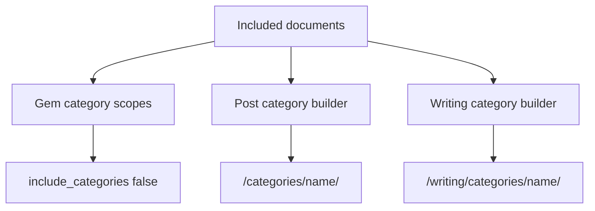

# Task: Writing collection

* Task ID: writing-collection
* Complexity: Level 3
* Type: feature

A `writing` collection beside posts and the garden. Categories come from folders. The filename prefix is the publication date. The URL is `/writing/<folder>/<slug>` with no date. The page shows the publication date and the git update date. The collection has its own layout, indexes, and LLM sidecars, joins the main feed, and stays out of the tech post indexes and the garden. Three seed pieces make the categories and tags visible.

## Pinned Info

### From file to page

The URL is baked the first time anything reads `document.url`. The folder has to be a category before that read. The filename date is applied when the document is read, which is after `post_init` and before render.

### Where category scopes go

`jekyll-llm-sidecars` builds one scope per category in the census, and it always uses the posts permalink `/categories/:name/`. A writing folder would publish `/categories/poetry/llms.txt`. Writing scopes have to be registered by this site, on the writing permalinks, with that gem flag off.

## Component Analysis

### Affected Components

- `_config.yaml`: collection, permalink, archive permalinks, reading-progress default, LLM include path, `include_categories`, and `exclude_paths` → add `writing` without putting it in `site.posts`, turn the gem's category scopes off, and exclude writing archive pages
- New `_plugins/writing_categories.rb`: nothing today assigns a category from a folder inside a collection → set `categories` from the path at `:documents, :post_init`, and leave a future filename date unpublished
- `_plugins/garden_in_feed.rb`: concatenates `site.garden` into `/feed.xml` → also concatenate `site.writing` when that collection exists
- `_plugins/garden_archives.rb`: already builds tag and category archives for any configured collection, title-sorts them, and skips singleton tags → configure `writing`; do not change garden sort or the garden-only hash fallback
- `_plugins/20_llms_scope_builders.rb`: post tags, garden tags, and authors → add writing tag scopes, writing category scopes, and post category scopes
- `_plugins/tag_descriptions_seo.rb`: allows `tag-archive` and `garden-tag-archive` → allow the writing tag layout so one shared `_data/tags.yaml` entry can describe a writing tag
- `_layouts/author-archive.html` and `pages/authors.md`: list `site.posts` only → also list `site.writing`
- New `_layouts/writing.html`, `_layouts/writing-tag-archive.html`, `_layouts/writing-cat-archive.html`: writing pages and their archives
- New `pages/writing.md`, `pages/writing/tags.md`, `pages/writing/categories.md`, `_data/writing_menu.yaml`, and a section in `pages/index.md`: the section a reader clicks into
- `pages/all-posts.md`, `pages/garden.md`, and `_data/menu.yaml`: already posts-only or garden-only → leave them unchanged and test that writing stays out
- New seed files under `_writing/poetry/`, `_writing/songs/`, and `_writing/stories/`
- `REUSE.toml`: CC-BY-SA-4.0 override for `blog/**` and `_garden/**` → add `_writing/**`
- `README.md`: the CC-BY-SA-4.0 line names `blog/` and `_garden/` → name `_writing/`
- `_plugins/README.md`: documents the feed concat and the LLM scopes → name writing
- `tests/test_garden_feed.py` and new `tests/test_writing_collection.py`: throwaway Jekyll builds

### Cross-Module Dependencies

- `writing_categories.rb` → Jekyll `Document#url`: categories must exist before the first URL read. The same hook runs before `read`, so a future-date check parses the filename. The collection adds the document only when `published?` is still true after `read`
- `writing_categories.rb` → `garden_archives.rb`: archives and `site.writing_tags` / `site.writing_categories` read `data["categories"]` and `data["tags"]`. Those hashes are built only for collections listed under `jekyll-archives.collections`, plus the existing garden fallback
- `writing_categories.rb` → collection permalink `:categories` and `:title`: the folder and the stripped slug
- `collection_dates.rb` → writing documents: leaves a filename date in place when it differs from `site.time`, and sets `last_modified` from the last body commit, then the last commit, then `File.mtime`
- `garden_in_feed.rb` → `jekyll-feed`: concat happens before the gem's date sort and `posts_limit`
- `20_llms_scope_builders.rb` → `jekyll-llm-sidecars` entry list: author scopes follow `include_paths`. The gem's own category scopes use `jekyll-archives.permalinks.category`. Tag and category scopes this site owns need an explicit builder
- `pages/index.md` → upstream `no-style-please` home layout: the layout renders `site.data.menu` and then `{{ content }}`, so a writing block in `index.md` shows under the posts menu. The throwaway fixture does not fetch the remote theme, so it stubs that layout
- `_includes/page_list.html` → writing menu: it already lists `site[collection]` sorted by a key
- `_includes/post_list.html` → recent posts: the theme include lists `site.posts` when the menu entry has no collection

### Boundary Changes

- New public URLs under `/writing/`
- Piece URL is `/writing/<folder>/<slug>`. The folder's archive is `/writing/categories/<folder>/`
- `/feed.xml` gains writing entries, still capped at the existing newest-ten
- `/authors/:author/` lists writing pieces as well as posts
- `/tags/` and `/categories/` stay posts-only, including their `llms.txt` scopes
- `/garden/` stays garden-only
- `/all-posts.html` and the home recent-posts list stay posts-only
- No new gem and no change to post permalinks

### Invariants

- A writing piece has no `date` and no `category` in front matter
- The publication date is the `YYYY-MM-DD` filename prefix
- The update date is the git body-commit date from `collection_dates.rb`, with the existing mtime fallback
- The piece URL contains the folder and the slug and does not contain the date
- Tech post indexes and the garden index do not list writing pieces
- Tag descriptions stay one global meaning per tag name in `_data/tags.yaml`
- A tag on one writing document does not get an archive page or an index link
- A category gets an archive page and an index link even when only one piece uses it
- A writing folder does not get an LLM scope at `/categories/<folder>/`
- A post category still gets an LLM scope at `/categories/<name>/`
- Writing archive pages do not get a Markdown sidecar
- Seeds are dated `2026-11-11`, authored by `texarkanine`, and are one poem, one song, and one story
- A writing piece whose filename date is after the build time is absent from `site.writing`
- `_writing/**` is CC-BY-SA-4.0, the same override as posts and the garden

## Open Questions

- [x] Piece path versus acceptance criterion 1 → Resolved: the piece URL stays `/writing/<folder>/<slug>`. The folder's archive is `/writing/categories/<folder>/`. Acceptance criterion 1 in the brief now says that.
- [x] Category LLM scopes → Resolved: set `include_categories` to false and register explicit builders for post categories and writing categories.
- [x] Seed license → Resolved: `_writing/**` uses the same CC-BY-SA-4.0 override as `blog/**` and `_garden/**`.

## Test Plan (TDD)

### Behaviors to Verify

- Folder and filename → a file `_writing/poetry/2026-11-11-porch-light.md` with no `date` and no `category` builds at `/writing/poetry/porch-light.html`, and the HTML publication date is `2026-11-11`
- Nested folder → `_writing/poetry/sonnets/2026-11-11-porch-light.md` builds at `/writing/poetry/sonnets/porch-light.html`
- No folder → `_writing/2026-11-11-porch-light.md` builds at `/writing/porch-light.html` with no double slash
- Posts stay posts → the same build's `site.posts` listing does not contain that URL
- Future filename → `_writing/poetry/2999-01-01-later.md` is absent from a `site.writing` listing and its HTML file is absent. The same-day piece stays listed
- Feed order → a writing piece dated between two posts appears between them in `/feed.xml`
- Feed cap → `posts_limit: 1` keeps the newer of a post and a writing piece
- Feed without garden → a writing piece still joins the posts feed when the garden collection is absent
- Draft and unpublished → `draft: true` and `published: false` stay out of the feed
- Tag archive → a tag on two writing pieces publishes `/writing/tags/verse/` and does not publish a tag used once
- Category archive → `/writing/categories/poetry/` exists for one piece
- Post tag namespace → `/tags/verse/` is not created for a writing-only tag
- Layout → the writing page links the category to `/writing/categories/poetry/`, links the author to `/authors/texarkanine/`, and shows the filename day as Published and the file mtime day as Updated
- No tags on the page → a writing piece with no tags still renders, and the page has no tag link
- Shared tag description → a fixture `_data/tags.yaml` entry `verse: "A **shared** description."` is markdownified in the body of `/writing/tags/verse/`, and that page's description text is `A shared description.`
- Author page → a hand-written author page lists the writing piece and a post, newest first
- Document sidecar → `/writing/poetry/porch-light.md` exists
- Writing tag scope → `/writing/tags/verse/llms.txt` exists, and a singleton tag has no `llms.txt`
- Writing category scope → `/writing/categories/poetry/llms.txt` exists for one piece
- Post category scope → a post in category `tools` still publishes `/categories/tools/llms.txt` after `include_categories` is false
- Posts category namespace → `/categories/poetry/llms.txt` is absent when only a writing folder is named poetry
- Archive sidecars → `/writing/tags/verse/index.md` and `/writing/categories/poetry/index.md` are absent
- Section home → `/writing/` lists writing pieces by date, newest first, and does not list a post or a garden note
- Tag index → `/writing/tags/` links a tag used twice, omits a tag used once, does not link a post-only tag, and still renders when the only piece has no tags
- Category index → `/writing/categories/` links a category used once, and does not link a post category
- Home block → the recent-posts list does not link the writing piece, and the writing block under that list links the piece, `/writing/`, `/writing/tags/`, and `/writing/categories/`, newest first
- Post index → `/all-posts.html` does not list the writing piece
- Garden index → `/garden/` does not list the writing piece
- Existing garden feed cases → still pass with no writing collection configured

### Test Infrastructure

- Framework: `python3 -m unittest`, throwaway `jekyll build` fixtures
- Test location: `tests/`
- Conventions: `tests/test_garden_feed.py` copies a plugin into a temp source, sets `BUNDLE_GEMFILE` and `JEKYLL_NO_BUNDLER_REQUIRE=1`, and reads the built files. That feed fixture keeps its own minimal config, because the feed behavior is in the copied plugin
- New test files: `tests/test_writing_collection.py`
- Production config: units 1, 3, 4, and 5 build with `bundle exec jekyll build --source <fixture> --destination <dest> --config <repo>/_config.yaml,<fixture>/overlay.yml`. Jekyll deep-merges those files. A later array replaces an earlier array. A later null leaves the earlier value in place. The overlay sets `url` and replaces `plugins` with the offline-safe list for that case. It does not set `collections`, `defaults`, `jekyll-archives`, `llm_sidecars`, or `future`. The permalink, the writing defaults, the archive permalinks, `include_categories`, `include_paths`, and `exclude_paths` are whatever the repository `_config.yaml` says at that step. The fixture holds the documents, the copied plugins, the stubbed layouts, and the overlay. It does not write its own `_config.yml`

### Integration Tests

- `tests/test_writing_collection.py`: category hook, permalink, archives, layout, author page, sidecars, and the section indexes in one throwaway site
- `tests/test_garden_feed.py`: writing documents concatenated into the posts feed, including the no-garden and limit cases

## Implementation Plan

### 1. Folder categories and dateless URLs — executable

- Files: `tests/test_writing_collection.py`, `_plugins/writing_categories.rb`, `_config.yaml`

1. Stub tests: add `tests/test_writing_collection.py` with empty cases for the folder URL, the nested URL, the folderless URL, the publication date in the HTML, absence from a `site.posts` listing, and a future filename absent from a `site.writing` listing.
2. Stub interface: add `_plugins/writing_categories.rb` with the `:documents, :post_init` hook and an empty body, and add the `writing` collection permalink `/writing/:categories/:title:output_ext` in `_config.yaml`.
3. Write tests and run red: the fixture uses the shared `--config` helper. The overlay's plugin list is empty. The fixture copies the plugin, stubs `_layouts/writing.html` as `{{ content }}`, and writes Markdown with a title and no date or category. The document body is `{{ page.date | date: "%Y-%m-%d" }}`. It asserts the destination paths and the date text. The posts listing is a fixture page that loops `site.posts`. The writing listing is a fixture page that loops `site.writing`. Run `python3 -m unittest tests.test_writing_collection`. The folder URL fails because the hook has not set categories. The future piece is still listed, so that case fails too. Jekyll already skips writing its HTML.
4. Write code and run green: the hook, for collection `writing` only, sets `categories` to the directory segments under `_writing`. Do not call `url` from the hook. The hook runs before `read`, so `data["date"]` is not set yet. Parse the filename with `Jekyll::Document::DATE_FILENAME_MATCHER`. When `site.future` is false and that date is after `site.time`, set `published` to false. `read` keeps that value when the front matter has no `published` key, and the collection then leaves the document out of `site.writing`. Re-run the writing tests and `python3 -m unittest discover -s tests`.

### 2. Main feed — executable

- Files: `tests/test_garden_feed.py`, `_plugins/garden_in_feed.rb`

1. Stub tests: add empty cases for date order, `posts_limit`, a missing garden collection, `draft: true`, and `published: false`.
2. Stub interface: none. The feed plugin already exists.
3. Write tests and run red: extend the fixture to write `_writing/<folder>/<YYYY-MM-DD-slug>.md` and assert Atom link order. Run the new cases. They fail while the concat ignores writing.
4. Write code and run green: when the feed page's collection is `posts`, concatenate `site.garden` and `site.writing` only if that collection exists. Leave tag feeds and other collection feeds on their own lists. Re-run `python3 -m unittest discover -s tests`.

### 3. Layout, archives, and author pages — executable

- Files: `tests/test_writing_collection.py`, `_layouts/writing.html`, `_layouts/writing-tag-archive.html`, `_layouts/writing-cat-archive.html`, `_config.yaml`, `_layouts/author-archive.html`, `pages/authors.md`, `_plugins/tag_descriptions_seo.rb`

1. Stub tests: add empty cases for the category link, both dates, the tag archive, the absent singleton tag, the category archive, the untouched `/tags/` path, the author page listing both a post and a writing piece, and a piece with no tags, and the shared `verse` description on the tag archive.
2. Stub interface: add the three layouts with empty bodies. In `_config.yaml`, add the `writing` block under `jekyll-archives.collections` with `enabled: [tags, categories]`, layouts `tag: writing-tag-archive` and `category: writing-cat-archive`, and permalinks `/writing/tags/:name/` and `/writing/categories/:name/`.
3. Write tests and run red: the fixture uses the shared `--config` helper. The overlay's plugin list is `jekyll-archives` only. It copies `writing_categories.rb`, `garden_archives.rb`, `navigational_tags.rb`, `collection_dates.rb`, `tag_descriptions_seo.rb`, `_includes/back_link.html`, `_layouts/page.html`, and the production layouts. It writes `_data/tags.yaml` with `verse: "A **shared** description."`. It stubs `_layouts/default.html` so the output is `{{ content }}` and `{{ page.description }}`. It writes `_data/authors.yaml` for `texarkanine` with a name and a bio and no contact entry, and a hand-written page with `layout: author-archive`, `title: texarkanine`, and `permalink: /authors/texarkanine/`. It does not enable `jekyll-auto-authors`. The writing documents do not set `layout` or `reading_progress`. It sets the writing file's mtime and asserts Published is the filename day and Updated is that mtime day. It asserts `/writing/tags/verse/` contains the markdownified description and the plain text `A shared description.` A nested piece's page links `/writing/categories/poetry/` and `/writing/categories/sonnets/`. Run the new cases. The description assertions fail. The archive path can already exist because the config block is in place.
4. Write code and run green: the writing layout shows Published from `page.date` and Updated from `page.last_modified`, links each category segment to `/writing/categories/<slug>/`. A piece in `poetry` links `/writing/categories/poetry/`. A piece in `poetry/sonnets` links `/writing/categories/poetry/` and `/writing/categories/sonnets/`. It links `page.author` to `/authors/`, and it links a tag to `/writing/tags/` only when that tag's writing count is at least 2. Read tags as `site.writing_tags | default: site.data.writing_tags`, and categories the same way, so a piece with no tags still renders and shows no tag link. Archive layouts list documents by date, newest first. The tag layout renders `site.data.tags[page.title]` through `markdownify`, the same way the garden tag layout does, and `writing-tag-archive` is added to `TAG_ARCHIVE_LAYOUTS` so the plain-text description is set. Author pages concatenate `site.writing` with `site.posts` and sort by date, newest first. In `_config.yaml`, set the writing default layout to `writing` and `reading_progress: true`. Re-run the suite.

### 4. LLM sidecars — executable

- Files: `tests/test_writing_collection.py`, `_config.yaml`, `_plugins/20_llms_scope_builders.rb`

1. Stub tests: add empty cases for the document sidecar, the writing tag `llms.txt`, the absent singleton tag scope, the writing category `llms.txt`, the absent `/categories/poetry/llms.txt`, the surviving post category `llms.txt`, and the absent archive `index.md` files.
2. Stub interface: add `writing` to `llm_sidecars.include_paths` in `_config.yaml` only. Leave `include_categories: true`. Leave `exclude_paths` unchanged. Leave the scope builders unchanged.
3. Write tests and run red: the fixture uses the shared `--config` helper. The overlay's plugin list is `jekyll-archives` and `jekyll-llm-sidecars`. It copies `20_llms_scope_builders.rb`, `navigational_tags.rb`, `garden_archives.rb`, and `writing_categories.rb`. A post uses category `tools`. The overlay does not set `include_categories`, `include_paths`, or `exclude_paths`. Run the new cases. The document sidecar and the post category scope can pass. The writing tag scope, the writing category scope, the absent `/categories/poetry/llms.txt`, and the absent archive `index.md` files fail.
4. Write code and run green: in `_config.yaml`, set `include_categories: false` and add `exclude_paths` entries `/writing/tags/**/*` and `/writing/categories/**/*`. Register a writing tag builder through `scopes_for_taxonomy`, using `site.writing_tags` and `/writing/tags/:name/`, so singleton tags stay out. Register post category and writing category builders that do not apply `NavigationalTags.keep?`. Post categories use `site.categories` and `jekyll-archives.permalinks.category`. Writing categories use `site.writing_categories` and the writing category permalink. Look up `writing_tags` and `writing_categories` the way `garden_tags` is looked up: `respond_to?`, then `site.data`, then `{}`. Re-run the suite.

### 5. Section indexes — executable

- Files: `tests/test_writing_collection.py`, `pages/writing.md`, `pages/writing/tags.md`, `pages/writing/categories.md`, `_data/writing_menu.yaml`, `pages/index.md`

1. Stub tests: add empty cases for the section home order and its exclusion of posts and garden notes, the tag index threshold, an empty tag index, the category index with one piece, the home block under the posts menu, `/all-posts.html`, and `/garden/`.
2. Stub interface: add `pages/writing.md`, `pages/writing/tags.md`, and `pages/writing/categories.md` with permalinks `/writing/`, `/writing/tags/`, and `/writing/categories/` and empty bodies. Add `_data/writing_menu.yaml` with an empty `entries` list. Do not edit `pages/index.md` yet.
3. Write tests and run red: the fixture uses the shared `--config` helper. The overlay's plugin list is `jekyll-archives`. It copies those pages, `pages/index.md`, `pages/all-posts.md`, `_layouts/page.html`, `_includes/back_link.html`, `_data/menu.yaml`, `_data/garden_menu.yaml`, `_includes/menu_item.html`, `_includes/page_list.html`, and `_includes/garden_posts.html`. It writes a fixture `_includes/post_list.html` that lists `site.posts`. It stubs `_layouts/home.html` to render the menu and then `{{ content }}`, and stubs `_layouts/default.html` to render `{{ content }}`. It copies `writing_categories.rb`, `garden_archives.rb`, and `navigational_tags.rb`. Two writing pieces have different filename dates and share `verse`. One of them uses `hearth`. A third piece has no tags. A post uses tag `tools` and category `tools`. It writes a fixture page at `/garden/` whose body is ``. It does not copy `pages/garden.md`, because that page links `_garden/what-is-a-digital-garden.md` and that note uses `linkcard`. A garden note is present. Run the new cases. They fail.
4. Write code and run green: `pages/writing.md` lists `site.writing` by date, newest first, and links to `/writing/tags/` and `/writing/categories/`. `pages/writing/tags.md` lists `site.writing_tags | default: site.data.writing_tags` and omits a tag whose count is under 2. An empty tag set still renders the page with no tag links. `pages/writing/categories.md` lists `site.writing_categories | default: site.data.writing_categories`, including a category with one piece. `_data/writing_menu.yaml` lists `site.writing` by date, newest first, with links to `/writing/`, `/writing/tags/`, and `/writing/categories/`. `pages/index.md` renders that menu in the page body. Do not add writing to `_data/menu.yaml`. Re-run the suite.

### 6. Seed pieces and license — prose/policy

- Files: `_writing/poetry/2026-11-11-porch-light.md`, `_writing/songs/2026-11-11-kitchen-radio.md`, `_writing/stories/2026-11-11-the-second-cup.md`, `REUSE.toml`, `README.md`, `_data/tags.yaml`
- No tests: prose/policy artifact

1. Write three short original pieces. Front matter is title, description, layout, author `texarkanine`, and tags only. Poem tags: `verse`, `night`. Song tags: `verse`, `night`. Story tags: `night`, `hearth`. No `date`. No `category`.
2. Add `_writing/**` to the CC-BY-SA-4.0 annotation in `REUSE.toml`, and name `_writing/` in the comment that lists the creative-writing paths. In `README.md`, add `_writing/` to the CC-BY-SA-4.0 line that lists `blog/` and `_garden/`.
3. Add `verse` and `night` to `_data/tags.yaml`, one sentence each, in the existing folded style. Do not add `hearth`.

### 7. Plugin notes — prose/policy

- Files: `_plugins/README.md`
- No tests: prose/policy artifact

1. Note that the posts feed also concatenates `site.writing`, that writing categories come from folders at `post_init`, that a future filename date is left unpublished there, that writing tag and category LLM scopes are registered by this site, that `include_categories` is false because the gem's category scope uses the posts permalink, and that `/writing/tags/**/*` and `/writing/categories/**/*` are excluded so archive pages do not get Markdown sidecars. Note that a writing folder is not named `tags` or `categories`, because that name would share the archive URL and match those exclude globs.

## Technology Validation

No new technology - validation not required

## Challenges & Mitigations

- URL memoized too early: the category hook runs at `post_init` and must not read `url`. The URL test asserts the folder segment.
- Archive permalink fallback: `garden_archives.rb` falls back to `/tags/` and `/categories/` when a collection omits permalinks. The writing archive config sets both permalinks, and the test asserts `/tags/verse/` is absent.
- Feed assign-line drift: a gem bump that changes the posts assignment leaves the template untouched and drops writing silently. The feed test asserts a writing link.
- Filename date versus git date: `collection_dates.rb` keeps a `data["date"]` that is already set and differs from `site.time`. Jekyll sets that from the filename before generators run. The publication-date assertion uses the filename. The Updated assertion uses the fixture file's mtime, which is the plugin's fallback when the throwaway file has no commit.
- Same-day update line: the writing layout always shows Updated, including when it matches the publication day, so a new seed still shows both lines.
- Garden title sort: writing archive layouts re-sort by date. Garden tag pages stay title-sorted.
- Category scope minimum: `scopes_for_taxonomy` drops a term with one document. Category builders must not use that filter, or a one-piece category loses its `llms.txt`. The poetry category case has one piece.
- Post category regression: `include_categories: false` removes the gem's post category scopes. The `tools` case fails unless the post category builder lands in the same change.
- Home layout: the throwaway site does not load the remote theme. The fixture stubs the home layout that renders the menu and then `{{ content }}`. The recent-posts list is a fixture `post_list.html` that lists `site.posts`.
- Author page weight: the author case is a hand-written page. The author record has no email, so the fixture does not load `jekyll-auto-authors` or `email_obfuscator.rb`.
- Future filename dates: Jekyll does not write the page, and it still leaves the document in the collection, so indexes and the feed would link to a missing page. The hook sets `published` false from the filename before `read` returns. The collection then omits the document. The seeds are dated today. `site.future` stays false.
- Overlay nulls: a null value in the second config file does not erase the first file's value. The overlay replaces the `plugins` array. It does not try to null `remote_theme`.
- `index.md` inside a category folder would be another piece. The seeds do not add one.
- Empty taxonomy hashes: `garden_archives.rb` defines `site.writing_tags` only when the hash is non-empty. Layouts, indexes, and scope builders use the garden guard, and the no-tag case renders the page and the tag index.
- Reserved folder names: a folder named `tags` or `categories` would collide with the archive URLs and the new exclude globs. The plugin note records that. The seeds use `poetry`, `songs`, and `stories`. No rename filter in this task.
- Config-list refactor: replacing the hard-coded collection names in the feed, scope, and archive plugins with config lists is outside this task.

## Pre-Mortem

- Categories set too late, so every piece publishes at `/writing/<slug>` and the folders are only a filing convenience. The URL test locks the folder segment, and the hook is `post_init` rather than a generator.
- A seed gets a front-matter `date` or `category`, the filename stops being the publication date, and the folder stops being the only category source. The mechanism tests use documents without those keys. The seed step forbids the keys.
- The feed concat is nested under the garden check, so writing disappears on a site with no garden. The missing-garden feed case prevents that shape.
- Writing tag pages land on `/tags/` and overwrite or mix with post tags. The archive permalink test and the explicit writing permalinks are the response.
- Writing category scopes land on `/categories/` and share a path with a post category of the same name. `include_categories: false`, the explicit writing permalink, and the absent `/categories/poetry/llms.txt` case are the response.
- Index Liquid ships untested, so a singleton tag or a tech post shows up on a writing index. Unit 5 builds `/writing/`, `/writing/tags/`, `/writing/categories/`, the home block, `/all-posts.html`, and `/garden/` before those pages are filled in.
- The seeds ship under the AGPL default. The REUSE step adds `_writing/**` to the CC-BY-SA-4.0 override in the same unit as the files.
- Acceptance criterion 1 is read as a piece living at `/writing/poetry/`. The brief now states the piece URL and the category archive URL, and this plan does not add a folder index.
- The fixture restates the permalink and the LLM flags, so a typo in `_config.yaml` stays green. Units 1, 3, 4, and 5 load the repository config, and the overlay does not set those keys.
- The writing tag description is only a constant and a layout lookup, so a missed layout name ships a blank blurb. The `verse` archive case asserts the markdown body and the plain description.
- A future filename stays listed, and the indexes link to a page Jekyll did not write. The hook unpublishes it from the filename before the collection accepts the document. The 2999 listing is the test.

## Status

- [x] Component analysis complete
- [x] Open questions resolved
- [x] Test planning complete (TDD)
- [x] Implementation plan complete
- [x] Technology validation complete
- [x] Pre-Mortem complete
- [x] Preflight
- [x] Build
  - [x] 1. Folder categories and dateless URLs
  - [x] 2. Main feed
  - [x] 3. Layout, archives, and author pages
  - [x] 4. LLM sidecars
  - [x] 5. Section indexes
  - [x] 6. Seed pieces and license
  - [x] 7. Plugin notes
- [x] QA
- [x] Reflect

## QA Results

Status: PASS

- KISS: Direct, minimal implementation using standard Jekyll `:documents, :post_init` hook and built-in features without unnecessary abstraction.
- DRY: Reused existing archive and tag infrastructure; unified LLM taxonomy scope generation across post, garden, and writing collections.
- YAGNI: No speculative features or dead code added; strictly satisfied all 10 requirements and 8 acceptance criteria.
- Completeness: All 7 implementation units completed and tested; all 52 tests pass cleanly; no TODOs or temporary scaffolding.
- Regression: Full test suite passes; posts, garden notes, author pages, and LLM sidecars remain strictly partitioned with zero regressions.
- Integrity: Seed pieces have complete original content and valid metadata; dates are accurately derived from filenames and git commit timestamps.
- Documentation: Updated `README.md`, `REUSE.toml`, and `_plugins/README.md` to reflect the new collection, licensing, feed integration, category hook, and LLM sidecars.
