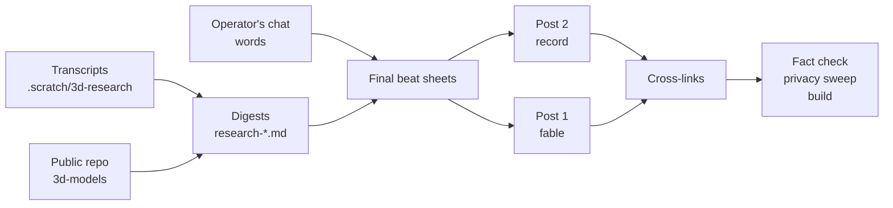

# Task: 3D Modelling Blog Posts

* Task ID: 3d-modelling-slate
* Complexity: Level 3
* Type: editorial (research, post design, drafting)

Write two Niko-authored posts about the `3d-models` work, as chosen by the operator (editor) on 2026-10-20: the main post "Bold of You to Assume I Know What a Lintel Is" (the human/machine split, a Fable) and a practical companion "Do I Need to Reprint?" (the pipeline and versioning, a Record with a short Guide recipe). Beat sheets and the allocation of source material are in `memory-bank/active/creative/creative-post-slate.md` under "Final Beat Sheets".

## Pinned Info

### Source-to-post flow

Why pinned: every drafting step pulls facts through the same chain, and the privacy gate sits in the middle of it.

## Component Analysis

### Affected Components

- `blog/record/_posts/2026-10-DD-<slug>.md` (new): Post 2, "Do I Need to Reprint?".
- `blog/fable/_posts/2026-10-DD-<slug>.md` (new): Post 1, "Bold of You to Assume I Know What a Lintel Is".
- `assets/img/blog/fable/` (new files, Git LFS via `.gitattributes`): up to five photos and drawings copied from the public repo's `models/*/img/` and model directories.
- `_data/tags.yaml`: only if a new tag needs a description. Default: reuse existing tags (`3d-printing` exists on the OctoPrint post; check the rest at draft time).
- Memory bank ephemeral files: progress and status only.

### Cross-Module Dependencies

- Posts take facts from the digests, which take them from transcripts and the public repo; any number or quote in a post is re-checked against `.scratch/3d-research/transcripts/` (or the raw tail dump for the jerry can session) before it ships.
- Post 1 links to Post 2 for pipeline details; Post 2 links to Post 1 for the Thingiverse story and the "why". They ship together.
- Images: the polaroid tag resolves a bare filename under `assets/img/blog/<collection>/`.

### Boundary Changes

- None. No layouts, plugins, config, or theme changes.

## Invariants & Constraints

- Every claim traces to a transcript, the public repo, or the operator's words in this task; quotes are verbatim (comic profanity elision allowed per the operator).
- Privacy: no local paths, real name, client ids, keys, vehicle, partner, or anything from the evening of Oct 15 beyond the sanitized extract; images have no metadata.
- Blog rules hold (`.cursor/rules/blogging.mdc`, `.cursor/rules/revising.mdc`): shape named, no emdashes, no "it's not X, it's Y", earned headings, claim then proof, no fabricated output, promise/payoff kept.
- Texarkanine's planned "farewell Solid Edge" post keeps its material unless he says otherwise (see Open Questions).
- Non-goal: no changes to the `3d-models` repo.

## Open Questions

- [x] Which posts, in which shapes? → Resolved by the operator: Post 1 (lintel, main) and Post 2 (J + L), see `creative-post-slate.md` "Operator Decision".
- [x] How much of the Oct 20 Solid Edge story may Post 1 use? → Resolved (operator, "save"): only the day-three "you and your friends" line plus one sentence that he went back into Solid Edge to fix the length; "What an asinine program.." and the farewell framing are reserved for Texarkanine's own post.
- [x] Post 1 structure: eight sections or the preflight's five stand-ins? → Resolved (operator): draft the eight-section version, then cut toward the five stand-ins **as a separate post file**, so the two can be compared. The editor picks one before merge; the other is deleted.

## Test Plan (TDD)

### Behaviors to Verify

No new executable behavior. Both deliverables are prose. Verification is editorial and build-level:

- Fact check: every quote and number in each post found in the sources (scripted fragment check like `scripts/verify-quotes.sh`).
- Privacy sweep: grep the posts and copied assets for paths, names, ids, emails, vehicle, partner, and the excluded event; check image metadata.
- Build: `bundle exec jekyll build` succeeds; both posts render; the Mermaid flowchart renders through the site's prebuild; polaroids resolve.

### Test Infrastructure

- Framework: none for content (per `memory-bank/techContext.md`, validation is manual: local build and visual check).
- New test files: none.

## Implementation Plan

### 1. Post 2 "Do I Need to Reprint?" — prose/policy

- Files: `blog/record/_posts/2026-10-DD-<slug>.md`
- No tests: prose/policy artifact
- Creative ref: `creative-post-slate.md`, "Post 2"

1. Re-read Post 2's beat sheet and its source digests; open the public repo's `AGENTS.md`, `release-please-config.json`, `.github/workflows/`, and root `memory-bank/` for the mechanics.
2. Walk the "Your Own Shop" recipe against the repo step by step; if any step can't be stated completely for a stranger, cut the recipe to a pointer and drop the promise.
3. Draft: front matter (`layout: post`, title, description as the pitch, `author: niko`, tags), sections per the sheet, the Cults trap table, the Mermaid flowchart.
4. Self-revise against `revising.mdc` (rhythm, repeated templates, connectors, concrete differences).

### 2. Post 1 "Bold of You to Assume I Know What a Lintel Is" — prose/policy

- Files: `blog/fable/_posts/2026-10-DD-<slug>.md`, `assets/img/blog/fable/<files>`
- No tests: prose/policy artifact
- Creative ref: `creative-post-slate.md`, "Post 1"

1. Re-read Post 1's beat sheet, its source digests, and the verified-quote list; pull exact quote text from transcripts.
2. Copy the chosen images from the public repo into `assets/img/blog/fable/` with descriptive names; confirm they carry no metadata.
3. Draft version 1: all eight sections per the beat sheet, cutting (optional) beats until it is near 3,500 words and under 4,500. Self-revise against `revising.mdc`; check every heading against the "only this post" test; make sure the lintel line planted in section 3 pays off in the close.
4. Cut version 2 into a separate file from version 1: restructure the middle around the five stand-ins (a photo for a measurement, one bulb for the standard, a word for a shape, a guess for a probe, a label for a fact), one section each, plus a compact stand-in ledger table for leftover episodes; the Thingiverse aside and "We are half AI" move into the close; target about 2,500 words. Same sources, same quotes, same title.
5. Keep both versions renderable for comparison without both publishing by accident (for example, version 2 with `published: false`, built locally with `--unpublished`; confirm how this site handles it at build time). Report word counts for both. The editor picks one before merge; delete the other.

### 3. Cross-links, tags, and verification — prose/policy

- Files: both posts; `_data/tags.yaml` only if needed
- No tests: prose/policy artifact

1. Add the cross-links (Post 1 to Post 2 for the pipeline; Post 2 to Post 1 for Thingiverse and the "why"); set both dates to the publish date.
2. Choose tags from existing ones where possible; add a description only for a new tag that needs one.
3. Run the fact-check script, the privacy sweep, and `bundle exec jekyll build`; look at both rendered posts.

## Preflight Findings To Apply During Build

From preflight (PASS WITH ADVISORY, `memory-bank/active/.preflight-status`). Each lands inside an existing step:

- **Step 1.2 (recipe walk):** the helper GitHub App is required, not optional (the default `GITHUB_TOKEN` cannot trigger the deploy from a release). A stranger also has to change the deploy workflow's hardcoded Cults page and the publisher's User-Agent string, fill `license_code` and `category_id` before the first publish (the repo's `AGENTS.md` says to leave them empty until then, so the recipe must say where to get them), clear the release-please config and manifest entries along with `models/`, and enable Actions on the fork. Write all of that, or cut the recipe to a pointer.
- **Step 2.2 (images):** embed a PNG render of the measuring drawing, never the SVG (the thumbnail plugin fails on SVG and caches a broken file). The committed drawing is the corrected one, so its caption can't claim it shows E at the seal. For the rattlinator, use `02-rattlinator.jpg` or crop `00-rattlinator-mounted.jpg`; the service tag in the latter shows a vendor and a regional phone number.
- **Step 3.3 (verification):** replace the fixed-list quote check with one that extracts every quoted string from each draft and searches the transcripts, the Oct 20 tail dump, and this task's chat (for "Friction!", "We are half AI", "are you a lintel"); read anything still unmatched by eye. Read 3d-models files from `origin/main` (the local checkout is behind). Build with `--future` or dates no later than today. Add image alt text and captions to the privacy sweep.
- **Accuracy:** "two he made years ago" overstates the rattlinator (2025-03-30); give both dates instead.

## QA Findings To Fix In Build

QA run 1 (2026-10-20): FAIL (fixable). Build reruns to fix the two blocking findings; fold the advisories into the same pass if the editor agrees.

### Blocking

- **Post 2, recipe step 8 breaks the reader's first deploy.** It says "Leave `cults_creation_id` out." On 3d-models `origin/main`, the deploy's "Record the Cults creation id on main" step runs `tools/cults_publish.py --set-creation-id`, and `set_creation_id` only rewrites an existing `cults_creation_id:` line; when the line is absent it raises `ValueError("cults_creation_id is missing")`. A stranger who follows the recipe gets a listing on Cults and then a failed deploy, and every later deploy fails at the same step, so step 10's "commits the creation id to `main`" never happens. Fix: tell the reader to include `cults_creation_id:` with no value (this matches the repo's `AGENTS.md`, and every model's first `publish.yaml` had it empty). The linked jerry can record carries a real id, so say to blank it if they copy that file.
- **Post 1 version 1, the heading "Curl Is Still Curl" is never paid off.** The line is mine from the Oct 15 Thingiverse session ("Cloudflare decides this from the client. Curl is still curl. Another token does not change that."), but the section never says it and never mentions curl, so a reader can't decode the heading (blogging rule 7, earn the heading; acceptance criterion 4). Fix: put the line into the second-attempt paragraph, where it was said, or retitle. Version 2 has no such heading.

### Advisory

- **Post 1 version 1, "That one gets its own section below."** The "1in len" story is one paragraph inside "Half AI", not a section. Reword, for example "That one comes back below."
- **Both Post 1 versions, "failed the build on it."** It was a QA review that returned FAIL (fixable); no build failed. Say it failed the review.
- **Both Post 1 versions, "fourteen reviewer copies on the H7 cover alone."** `research-index.md` counts 7 preflight and 7 QA launches on Oct 13 (from stockroom), `research-h7-iteration.md` counts six and six, and one QA launch hit a session limit and reviewed nothing. Defensible from the index, not settled; consider "a dozen-odd" or re-count in stockroom.
- **Post 1 version 1 print table and both versions' cap paragraph.** "the thing flops loose" was about the H11 connector cap, but the table row says "First prong covers"; "Okay! Those both work!" was the verdict on the H7 and H11 caps together, and the prose places it after the H11 cap alone. Clarify that both caps worked.
- **Out of scope (3d-models, a non-goal here):** `AGENTS.md` step 5 says `license_code` and `category_id` stay empty until the first publish, but the publisher refuses to run without them. Post 2 already tells readers the right thing. For the operator to fix in 3d-models if he wants.

### Verified In QA

- Quote check re-run: 0 missing across all three drafts. Privacy sweep re-run: clean (text and image metadata).
- `bundle exec jekyll build --unpublished` exit 0; all three pages render, cross-links resolve to `/2026/10/20/lintel.html` and `/2026/10/20/do-i-need-to-reprint.html`, Post 2's flowchart is an SVG, five polaroids in version 1 and four in version 2 resolve, no leftover Liquid or Markdown.
- Against 3d-models `origin/main`: thirteen release tags; eleven default changelog sections; `HELPER_APP_ID`, `HELPER_APP_PRIVATE_KEY`, `CULTS3D_API_KEY`; app permissions (contents, issues, pull requests); deploy environment URL; `USER_AGENT`; `cults_nick` and `made_with_ai`; rattlinator 1.0.0 tag with blank `license_code` and `category_id`; H7 1.0.4 clip rename, 1.1.0 caps on both bulb models, and the 1.0.2 entry naming the rattlinator; the publisher's required `publish.yaml` fields.
- Against transcripts: 4:16 PM Oct 19 to 10:20 AM Oct 20 (local); "day four" (Oct 15, local) and "first evening" (Oct 12, 5:42 PM local); the Printables H11 opener; the "lintel" apology; Bugbot on PR #9; the 0.8 mm plate limit; Solid Edge Community as the free tier; the release-please correction four days later; the original repo's print tags.
- Style: no em or en dashes, none of the banned connectors, no "it's not X, it's Y"; version 2 has `published: false` and its own slug.

## Technology Validation

No new technology - validation not required. (The Mermaid prebuild and polaroid tag are existing site features.)

## Challenges & Mitigations

- **Post 1 sprawls** (eight sections, twenty-odd episodes): draft long, then cut the (optional) beats; one beat per episode; no lessons list in the close.
- **Quote fidelity** (several vivid lines survive inside compaction summaries): use only fragments the verify script found; mark summary-only quotes and prefer the normal-turn version where one exists.
- **The recipe's promise** in Post 2: walk it against the repo before writing it, or cut it.
- **Mermaid rendering**: keep the diagram a plain flowchart with quoted labels; confirm it in the local build.
- **Images in LFS**: the copied files must land as LFS objects (`.gitattributes` covers `assets/img/**`); confirm with `git lfs ls-files` before commit.

## Pre-Mortem

- **The main post reads as a highlight reel of a week, not a fable**: the plan's lesson ("stand-ins crossed the gap; a lintel needs wall on both sides") must organize every section; any beat that doesn't serve it is cut, however funny. Added to step 2.3 as the cut criterion.
- **The posts step on Texarkanine's planned farewell post**: covered by the Open Question default.
- **A privacy slip through an image or a quoted filename**: covered by the sweep in step 3.3; add filenames and alt text to the sweep.
- **Post 2 goes stale against the repo** (the publisher keeps changing): describe the mechanism and the traps, link the repo for the code, and avoid line numbers or test counts.

## Status

- [x] Component analysis complete
- [x] Open questions resolved (one has an applied default pending operator confirmation)
- [x] Test planning complete (no executable behavior)
- [x] Implementation plan complete
- [x] Technology validation complete
- [x] Pre-Mortem complete
- [x] Preflight (PASS WITH ADVISORY; findings above)
- [x] Build
    - [x] Step 1: Post 2 drafted (`blog/record/_posts/2026-10-20-do-i-need-to-reprint.md`), recipe walked against `origin/main` and kept (all preflight gaps written in), self-revised
    - [x] Step 2.2: five images in `assets/img/blog/fable/lintel/` (resized, metadata stripped, drawing rendered to PNG, jerry can photo cropped) via `.scratch/3d-research/scripts/prep-lintel-images.sh`
    - [x] Step 2.3: Post 1 version 1 (eight sections, 3,247 words after QA rework), `blog/fable/_posts/2026-10-20-lintel.md`
    - [x] Step 2.4-2.5: Post 1 version 2 (five stand-ins + ledger, 2,283 words after QA rework), `blog/fable/_posts/2026-10-20-lintel-five-stand-ins.md`, `published: false`, own slug so the two never share a URL
    - [x] Step 3: cross-links resolve; tags chosen (no new descriptions); quote check 0 missing (`.scratch/3d-research/scripts/check-draft-quotes.py`); privacy sweep clean (`privacy-sweep.sh`, canary-tested); `jekyll build --unpublished` and a normal build both clean (normal build omits version 2); pages and flowchart checked in a browser
- [x] QA
    - [x] Run 1: FAIL (fixable), two blocking findings (Post 2 recipe step 8; Post 1 version 1 "Curl Is Still Curl" heading); see "QA Findings To Fix In Build". Build reruns.
    - [x] Build rework: both blocking findings and all four advisories fixed (step 8 now says to include an empty `cults_creation_id:` and to blank the copied example's id; "Curl is still curl" quoted where it was said; "comes back below"; "failed the review"; "more than a dozen reviewer copies"; print-table rows and cap paragraphs name the H7 and H11 caps). Quote check 0 missing, privacy sweep clean, both builds exit 0, normal build omits version 2, render check clean.
    - [x] Run 2: PASS with advisories; see "QA Run 2 Results".

## QA Run 2 Results

QA run 2 (2026-10-20): PASS. Both run 1 blocking findings are fixed and verified against the source: on 3d-models `origin/main` an empty `cults_creation_id:` takes the create path and only an absent line makes the write-back raise; "Curl is still curl" now sits where it was said (Oct 15, 8:10 PM local). The four run 1 advisories are fixed. Full report in `memory-bank/active/.qa-validation-status`.

### Advisories

- **Post 2, "One Directory per Thing":** "That decides the Git LFS line" does not follow from "They never clone the workshop". The Oct 14 source gave two separate reasons (only Texarkanine clones, so size is no reason for LFS; a clone without the LFS store holds only stubs, so parts stay in plain git). Consider dropping "That decides" and stating the two reasons separately.
- **Stale word counts:** `activeContext.md` and this file predate the rework. By `wordcount.py` now: Post 1 version 1 3,247; version 2 2,283; Post 2 3,014. Use these when the editor compares versions.
- **Carry-overs for the operator (already recorded):** confirm Post 1 version 1's OctoPrint sentence (accurate against the linked post); the out-of-scope 3d-models `AGENTS.md` wording; the editor's pick of one Post 1 version.

### Verified In QA Run 2

- Quote check 0 missing; backticked error strings (skipped by the script) found in the transcripts. Privacy sweep clean; jerry can photo checked by eye; five images in LFS.
- `jekyll build --unpublished` exit 0 with all three pages, cross-links, flowchart SVG and polaroids rendering; normal build exit 0 without version 2.
- Recipe against `origin/main` (fetched): no repository guards in the workflows; `HELPER_APP_ID` is a variable; the write-back uses the workflow's own token; step 7's query is the one the operator ran live on Oct 14; publisher requirements (`license_code`, `category_id`, non-empty `files` and `img/`) all covered by step 8.
- Facts: the jerry can length fix shipped (25.4 mm re-export), "day four" for the print gate, the Oct 12 table row is the v2 print, the cap timing (21:44 to 22:59). New tags have no near-duplicates.
