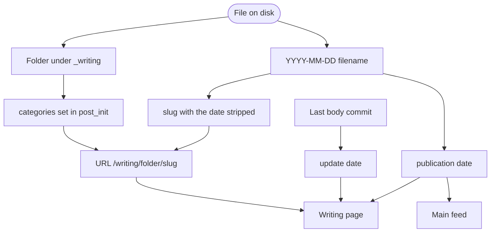

# Task: Writing collection

* Task ID: writing-collection
* Complexity: Level 3
* Type: feature

A `writing` collection beside posts and the garden. Categories come from folders. The filename prefix is the publication date. The URL is `/writing/<folder>/<slug>` with no date. The page shows the publication date and the git update date. The collection has its own layout, indexes, and LLM sidecars, joins the main feed, and stays out of the tech post indexes and the garden. Three seed pieces make the categories and tags visible.

## Pinned Info

### From file to page

The URL is baked the first time anything reads `document.url`. The folder has to be a category before that read. The filename date is applied when the document is read, which is after `post_init` and before render.

## Component Analysis

### Affected Components

- `_config.yaml`: collection, permalink, archive permalinks, reading-progress default, LLM include path → add `writing` without putting it in `site.posts`
- New `_plugins/writing_categories.rb`: nothing today assigns a category from a folder inside a collection → set `categories` from the path at `:documents, :post_init`
- `_plugins/garden_in_feed.rb`: concatenates `site.garden` into `/feed.xml` → also concatenate `site.writing` when that collection exists
- `_plugins/garden_archives.rb`: already builds tag and category archives for any configured collection, title-sorts them, and skips singleton tags → configure `writing`; do not change garden sort
- `_plugins/20_llms_scope_builders.rb`: post tags, garden tags, and authors → add writing tag and writing category scopes
- `_plugins/tag_descriptions_seo.rb`: allows `tag-archive` and `garden-tag-archive` → allow the writing tag layout so one shared `_data/tags.yaml` entry can describe a writing tag
- `_layouts/author-archive.html` and `pages/authors.md`: list `site.posts` only → also list `site.writing`
- New `_layouts/writing.html`, `_layouts/writing-tag-archive.html`, `_layouts/writing-cat-archive.html`: writing pages and their archives
- New `pages/writing.md`, `pages/writing/tags.md`, `pages/writing/categories.md`, `_data/writing_menu.yaml`, and a section in `pages/index.md`: the section a reader clicks into
- New seed files under `_writing/poetry/`, `_writing/songs/`, and `_writing/stories/`
- `_plugins/README.md`: documents the feed concat and the LLM scopes → name writing
- `tests/test_garden_feed.py` and new `tests/test_writing_collection.py`: throwaway Jekyll builds

### Cross-Module Dependencies

- `writing_categories.rb` → Jekyll `Document#url`: categories must exist before the first URL read
- `writing_categories.rb` → `garden_archives.rb`: archives read `data["categories"]` and `data["tags"]`
- `writing_categories.rb` → collection permalink `:categories` and `:title`: the folder and the stripped slug
- `collection_dates.rb` → writing documents: leaves a filename date in place and sets `last_modified` from the last body commit
- `garden_in_feed.rb` → `jekyll-feed`: concat happens before the gem's date sort and `posts_limit`
- `20_llms_scope_builders.rb` → `jekyll-llm-sidecars` entry list: author scopes follow `include_paths`; tag and category scopes need an explicit builder
- `pages/index.md` → upstream `no-style-please` home layout: the layout renders `site.data.menu` and then `{{ content }}`, so a writing block in `index.md` shows under the posts menu
- `_includes/page_list.html` → writing menu: it already lists `site[collection]` sorted by a key

### Boundary Changes

- New public URLs under `/writing/`
- `/feed.xml` gains writing entries, still capped at the existing newest-ten
- `/authors/:author/` lists writing pieces as well as posts
- `/tags/` and `/categories/` stay posts-only
- `/garden/` stays garden-only
- No new gem and no change to post permalinks

### Invariants

- A writing piece has no `date` and no `category` in front matter
- The publication date is the `YYYY-MM-DD` filename prefix
- The update date is the git body-commit date from `collection_dates.rb`
- The piece URL contains the folder and the slug and does not contain the date
- Tech post indexes and the garden index do not list writing pieces
- Tag descriptions stay one global meaning per tag name in `_data/tags.yaml`
- A tag on one writing document does not get an archive page
- A category gets an archive page even when only one piece uses it
- Seeds are dated `2026-11-11`, authored by `texarkanine`, and are one poem, one song, and one story

## Open Questions

None - implementation approach is clear

## Test Plan (TDD)

### Behaviors to Verify

- Folder and filename → a file `_writing/poetry/2026-11-11-porch-light.md` with no `date` and no `category` builds at `/writing/poetry/porch-light.html`, and the HTML publication date is `2026-11-11`
- Nested folder → `_writing/poetry/sonnets/2026-11-11-porch-light.md` builds at `/writing/poetry/sonnets/porch-light.html`
- No folder → `_writing/2026-11-11-porch-light.md` builds at `/writing/porch-light.html` with no double slash
- Posts stay posts → the same build's `site.posts` listing does not contain that URL
- Feed order → a writing piece dated between two posts appears between them in `/feed.xml`
- Feed cap → `posts_limit: 1` keeps the newer of a post and a writing piece
- Feed without garden → a writing piece still joins the posts feed when the garden collection is absent
- Draft and unpublished → `draft: true` and `published: false` stay out of the feed
- Tag archive → a tag on two writing pieces publishes `/writing/tags/verse/` and does not publish a tag used once
- Category archive → `/writing/categories/poetry/` exists for one piece
- Post tag namespace → `/tags/verse/` is not created for a writing-only tag
- Layout → the writing page links the category to `/writing/categories/poetry/`, links the author to `/authors/texarkanine/`, and shows published and updated dates
- Author page → Texarkanine's author page lists the writing piece and a post
- Sidecar → `/writing/poetry/porch-light.md` exists, and `/writing/tags/verse/llms.txt` exists
- Existing garden feed cases → still pass with no writing collection configured

### Test Infrastructure

- Framework: `python3 -m unittest`, throwaway `jekyll build` fixtures
- Test location: `tests/`
- Conventions: `tests/test_garden_feed.py` copies a plugin into a temp source, sets `BUNDLE_GEMFILE` and `JEKYLL_NO_BUNDLER_REQUIRE=1`, and reads the built files
- New test files: `tests/test_writing_collection.py`

### Integration Tests

- `tests/test_writing_collection.py`: category hook, permalink, archives, layout, author layout, and sidecar in one throwaway site
- `tests/test_garden_feed.py`: writing documents concatenated into the posts feed, including the no-garden and limit cases

## Implementation Plan

### 1. Folder categories and dateless URLs — executable

- Files: `tests/test_writing_collection.py`, `_plugins/writing_categories.rb`, `_config.yaml`

1. Stub tests: add `tests/test_writing_collection.py` with empty cases for the folder URL, the nested URL, the folderless URL, the publication date in the HTML, and absence from a `site.posts` listing.
2. Stub interface: add `_plugins/writing_categories.rb` with the `:documents, :post_init` hook and an empty body, and add the `writing` collection permalink `/writing/:categories/:title:output_ext` in `_config.yaml`.
3. Write tests and run red: the fixture copies the plugin, writes Markdown with a title and no date or category, builds, and asserts the destination paths and the date text. Run `python3 -m unittest tests.test_writing_collection`. The new cases fail.
4. Write code and run green: the hook, for collection `writing` only, sets `categories` to the directory segments under `_writing`. Do not call `url` from the hook. Re-run the writing tests and `python3 -m unittest discover -s tests`.

### 2. Main feed — executable

- Files: `tests/test_garden_feed.py`, `_plugins/garden_in_feed.rb`

1. Stub tests: add empty cases for date order, `posts_limit`, a missing garden collection, `draft: true`, and `published: false`.
2. Stub interface: none. The feed plugin already exists.
3. Write tests and run red: extend the fixture to write `_writing/<folder>/<YYYY-MM-DD-slug>.md` and assert Atom link order. Run the new cases. They fail while the concat ignores writing.
4. Write code and run green: when the feed page's collection is `posts`, concatenate `site.garden` and `site.writing` only if that collection exists. Leave tag feeds and other collection feeds on their own lists. Re-run `python3 -m unittest discover -s tests`.

### 3. Layout, archives, and author pages — executable

- Files: `tests/test_writing_collection.py`, `_layouts/writing.html`, `_layouts/writing-tag-archive.html`, `_layouts/writing-cat-archive.html`, `_config.yaml`, `_layouts/author-archive.html`, `pages/authors.md`, `_plugins/tag_descriptions_seo.rb`

1. Stub tests: add empty cases for the category link, both dates, the tag archive, the absent singleton tag, the category archive, the untouched `/tags/` path, and the author page listing both a post and a writing piece.
2. Stub interface: add the three layouts with empty bodies and the `writing` block under `jekyll-archives.collections` with permalinks `/writing/tags/:name/` and `/writing/categories/:name/`.
3. Write tests and run red: the fixture enables `jekyll-archives`, copies `garden_archives.rb` and the production layouts, and asserts the built HTML and paths. Run the new cases. They fail.
4. Write code and run green: the writing layout shows Published from `page.date` and Updated from `page.last_modified`, links the last category to `/writing/categories/`, links `page.author` to `/authors/`, and links a tag to `/writing/tags/` only when that tag's writing count is at least 2. Archive layouts list documents by date, newest first, and the tag layout renders `_data/tags.yaml` when an entry exists. Add `writing-tag-archive` to `TAG_ARCHIVE_LAYOUTS`. Author pages concatenate `site.writing` with `site.posts` and sort by date, newest first. Set the writing default layout to `writing` and `reading_progress: true`. Re-run the suite.

### 4. LLM sidecars — executable

- Files: `tests/test_writing_collection.py`, `_config.yaml`, `_plugins/20_llms_scope_builders.rb`

1. Stub tests: add empty cases for the document sidecar and the writing tag `llms.txt`.
2. Stub interface: add `writing` to `llm_sidecars.include_paths` only, leaving the scope builders unchanged so the tag-scope case can fail on its own.
3. Write tests and run red: the fixture enables `jekyll-llm-sidecars`, copies `20_llms_scope_builders.rb`, and asserts `/writing/poetry/porch-light.md` and `/writing/tags/verse/llms.txt`. Run the new cases. The tag scope fails.
4. Write code and run green: register writing tag and writing category scope builders the same way garden tags are registered, using `site.writing_tags` and `site.writing_categories` and the writing permalinks. Singleton tags stay out. Re-run the suite.

### 5. Section entry and seed pieces — prose/policy

- Files: `pages/index.md`, `pages/writing.md`, `pages/writing/tags.md`, `pages/writing/categories.md`, `_data/writing_menu.yaml`, `_writing/poetry/2026-11-11-porch-light.md`, `_writing/songs/2026-11-11-kitchen-radio.md`, `_writing/stories/2026-11-11-the-second-cup.md`
- No tests: prose/policy artifact

1. Add a writing block to `pages/index.md` and a `_data/writing_menu.yaml` that lists `site.writing` by date, newest first, with links to `/writing/`, `/writing/tags/`, and `/writing/categories/`. Do not add writing to `_data/menu.yaml`'s post list.
2. Add the section home, the tag index, and the category index, reading `site.writing`, `site.writing_tags`, and `site.writing_categories`. Indexes omit tags whose count is under 2. Category indexes include a category with one piece.
3. Write three short original pieces. Front matter is title, description, layout, author `texarkanine`, and tags only. Poem tags: `verse`, `night`. Song tags: `verse`, `night`. Story tags: `night`, `hearth`. No `date`. No `category`.

### 6. Plugin notes — prose/policy

- Files: `_plugins/README.md`
- No tests: prose/policy artifact

1. Note that the posts feed also concatenates `site.writing`, that writing categories come from folders at `post_init`, and that writing tag and category LLM scopes exist.

## Technology Validation

No new technology - validation not required

## Challenges & Mitigations

- URL memoized too early: the category hook runs at `post_init` and must not read `url`. The URL test asserts the folder segment.
- Archive permalink fallback: `garden_archives.rb` falls back to `/tags/` and `/categories/` when a collection omits permalinks. The writing archive config sets both permalinks, and the test asserts `/tags/verse/` is absent.
- Feed assign-line drift: a gem bump that changes the posts assignment leaves the template untouched and drops writing silently. The feed test asserts a writing link.
- Filename date versus git date: `collection_dates.rb` keeps a date that is already set. The publication-date assertion uses the filename. The update line is the existing git fallback.
- Garden title sort: writing archive layouts re-sort by date. Garden tag pages stay title-sorted.
- Same-day update line: the writing layout always shows Updated, including when it matches the publication day, so a new seed still shows both lines.
- Future filename dates: collection documents are not skipped the way future posts are. The seeds are dated today. No future-date filter in this task.
- `index.md` inside a category folder would be another piece. The seeds do not add one.

## Pre-Mortem

- Categories set too late, so every piece publishes at `/writing/<slug>` and the folders are only a filing convenience. The URL test locks the folder segment, and the hook is `post_init` rather than a generator.
- A seed gets a front-matter `date` or `category`, the filename stops being the publication date, and the folder stops being the only category source. The mechanism tests use documents without those keys. The seed step forbids the keys. A content grep of the three poems is not a test.
- The feed concat is nested under the garden check, so writing disappears on a site with no garden. The missing-garden feed case prevents that shape.
- Writing tag pages land on `/tags/` and overwrite or mix with post tags. The archive permalink test and the explicit writing permalinks are the response.

## Status

- [x] Component analysis complete
- [x] Open questions resolved
- [x] Test planning complete (TDD)
- [x] Implementation plan complete
- [x] Technology validation complete
- [x] Pre-Mortem complete
- [ ] Preflight
- [ ] Build
- [ ] QA
